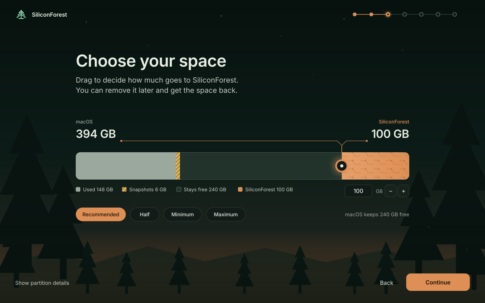

<!-- SPDX-License-Identifier: MIT -->
<!-- Copyright (c) 2026 Chris Kearney and the SiliconForest contributors -->

# SiliconForest Installer: architecture and design

CHL-27 phase 1, 22 November 2026.

> **Status: design only.** No part of this installer exists yet and nothing here has run on a Mac.
> The facts behind it are in [`RESEARCH.md`](RESEARCH.md), with the strength of each claim marked.
> Items that only a real Mac can settle are listed as spikes in [section 15](#15-spikes-before-we-commit).

| Document | Contents |
|---|---|
| **DESIGN.md** (this file) | Decisions, architecture, components, safety, signing, updates, testing, code layout, plan |
| [`UX-FLOW.md`](UX-FLOW.md) | Every screen with its copy, including failure, rollback and uninstall |
| [`VISUAL-DESIGN.md`](VISUAL-DESIGN.md) | Branding, type, colour, motion, dark and light, accessibility |
| [`ENGINE.md`](ENGINE.md) | Preflight, sizing, state machine, journal, rollback, dry run |
| [`ADDING-A-MAC.md`](ADDING-A-MAC.md) | The checklist for each future Mac |
| [`FIRST-INSTALL-J313.md`](FIRST-INSTALL-J313.md) | The M1 Air as first real install target: its state, board differences, order of work |
| [`RESEARCH.md`](RESEARCH.md) | Omacom, Asahi, Apple and UX research with sources |
| [`installer/profiles/`](../../installer/profiles/) | The J293 and J313 profiles and their JSON schema |



## 1. The product in one paragraph

SiliconForest Installer is a Mac app. You open it in macOS and it fills the screen. It checks the Mac, shows the disk as a
single beautiful bar you can drag, tells you exactly what will change, and then does the work with live, truthful progress.
Apple requires one step that no software can perform: you hold the power button and approve SiliconForest in recovery. The
installer teaches that step before it happens and meets you there with its own screen. It calls the installation finished
**only after SiliconForest has actually started on your Mac**. If that first start fails, the next power-on returns to
macOS. The same app removes SiliconForest and gives the space back.

## 2. What we keep, what we beat

| Area | Asahi installer | Omacom installer | SF-AJ (ours, unmerged) | **SiliconForest Installer** |
|---|---|---|---|---|
| Interface | Terminal menu | SwiftUI, 780×600 window | Terminal | **Fullscreen SwiftUI, one continuous flow** |
| Recovery step | Terminal script | AppKit app, 780×440 | Asahi's script | **Fullscreen AppKit app, with Asahi's script as an automatic fallback** |
| Engine | Python | Asahi Python + overlay, root Python with relaxed entitlements | Asahi Python + gate | **Native Swift port of v0.9.2, no interpreter in the root helper** |
| Privilege | `sudo` | SMJobBless (deprecated) | `sudo` | **SMAppService daemon, short-lived, pinned clients, typed verbs** |
| Disk view | Text | Draggable bar | Text | **Bar with used, free, snapshots and new space, plus typed size and presets** |
| Plan binding | None | Layout, plan and artifact digests | Layout digest | **Keep Omacom's model and add the live resize minimum** |
| Downloads | Streamed during the write | Prefetched | Whole, checked | **Everything verified before the first disk write** |
| Resize | Blocking | Blocking, its worst failure area | Blocking | **Supervised: reattaches, re-reads the truth, never kills a live resize** |
| Interrupted install | Partial repair | Journal, some dead ends | Journal | **Every journal state has a tested way forward or back** |
| "Done" means | Script ended | Recovery enrolled | Script ended | **SiliconForest booted and wrote a receipt** |
| Failed first boot | Boot loop possible | Boot loop reported on J293 | User resets default | **One-shot first boot returns to macOS** (spike S5) |
| Progress | Text | Mostly a timer | Text | **Real bytes and named phases** |
| Uninstall | None merged | Yes | Yes (model only) | **Yes, with default-boot repair, regrow and receipt** |
| Failure wording | Generic | Honest, proven from journal | One line | **Omacom's honesty plus the real Apple error and its specific fix** |
| Per-Mac data | Python tables | Signed catalog, code | TSV | **Declarative, schema-checked profile per Mac** |
| Telemetry | Optional install report | None found | None | **None** |

## 3. Decisions

| # | Decision | Why | Cost or risk |
|---|---|---|---|
| **D1** | **Decided by Chris: native Swift engine.** A port of the Asahi v0.9.2 engine, proven by differential tests against the real thing | A root helper with no interpreter and no relaxed entitlements. Byte-level progress. Fixes the known upstream hazards. v0.9.2 is MIT; upstream's next core may be GPL | The stub is the most field-tested code we would be rewriting. Fallback in [section 6.4](#64-fallback-for-d1) |
| **D2** | **SMAppService daemon, registered only while needed** | The supported API. Short life avoids its weakest area, upgrades | Requires Login Items approval. 13.x is the riskiest range (spikes S1, S2) |
| **D3** | **Recovery step is a small AppKit app started by a shell launcher**, which falls back to Terminal and our script if the app cannot start | SwiftUI and Python are absent from the 13.5 recoveryOS. The script launch path is the one Asahi ships | Fullscreen in recoveryOS is unproven (spike S3) |
| **D4** | **"Installed" means a boot receipt exists** | Omacom's J293 boot loop shows that enrollment is not success | Needs a small first-boot job and a reserved slot in the root image |
| **D5** | **The previous default stays the default. The first SiliconForest start is one-shot** | A failed start must land in a working system, because SiliconForest cannot change NVRAM. On the Air that system is Linux, not macOS | Depends on `bless --nextonly` in recovery (spike S5). Fallback in [section 8.3](#83-first-boot-and-the-boot-receipt) |
| **D6** | **All downloads and hashes finish before the first disk write** | A network failure then costs nothing | Temporary space on macOS, which the plan accounts for |
| **D7** | **Firmware comes from Apple's 13.5 recovery image for this Mac, extracted on the Mac** | The same version on every install, matching the one our drivers were brought up on. Nothing Apple-owned ships with us | **Accepted by Chris.** It differs from the live macOS, whose firmware version varies |
| **D8** | **No telemetry, no accounts, no background agent after install** | Trust | We learn about failures only from diagnostics users choose to send |
| **D9** | **The app enters native full screen at launch**, with no kiosk lockouts | Chris's brief. The HIG prefers user choice, so we keep every exit: Esc, the green button, Dock reveal, force quit | A deliberate, documented departure from the HIG |
| **D10** | **Deployment target macOS 13.5** | Do not force a macOS update, which also changes system firmware. The visual design does not need newer APIs ([`VISUAL-DESIGN.md`](VISUAL-DESIGN.md) section 7) | A wider test matrix |
| **D11** | **macOS 27 is a required target, gated on a real resize test** (spike S11). Later majors are refused until added | Chris's Pro is believed to run 27, and a resize failure was reported on 27.0.1 | Release builds refuse 27 until S11 passes |
| **D12** | **We never modify an install we did not create** | The development M1's hand-made layout, and any Asahi or Omarchy install, must be safe | Those users see a clear refusal instead of adoption |

## 4. Architecture

```
┌─────────────────────────────── macOS ────────────────────────────────┐
│                                                                      │
│  SiliconForest Installer.app  (user, SwiftUI, fullscreen)            │
│   ├─ SFDesign    tokens, The Grove background, disk bar, transitions │
│   ├─ SFCopy      every string, in one reviewed place                 │
│   ├─ SFFlow      the screen state machine                            │
│   └─ SFInstallKit (read-only half): probe, plan, verify release      │
│            │                                                         │
│            │  NSXPC, both ends pinned to our Developer ID            │
│            ▼                                                         │
│  SFHelper  (root, launchd via SMAppService, present only while used) │
│   └─ SFInstallKit (acting half): gate → journal → disk, stub,        │
│       firmware, boot object, bless, uninstall                        │
└───────────────────────────────┬──────────────────────────────────────┘
                                │ stages SFRecovery.app + plan on the stub
              shut down, hold power, choose SiliconForest
                                ▼
┌─────────────────────────── recoveryOS (paired 1TR) ──────────────────┐
│  launcher (sh) → SFRecovery (AppKit, root) → bputil, kmutil, bless   │
│        └── on any launch failure → Terminal + sf-step2.sh            │
└───────────────────────────────┬──────────────────────────────────────┘
                                ▼
┌──────────────────────── SiliconForest, first start ──────────────────┐
│  iBoot → m1n1 stage 1 → stage 2 → XNU → root → sf-firstboot          │
│        └── writes the boot receipt into its reserved slot            │
└───────────────────────────────┬──────────────────────────────────────┘
                                ▼
           Back in macOS: the app reads the receipt: Installed.
```

### What lands on the disk

```
Before  [ iSC ][ macOS container                              ][ Recovery ]
After   [ iSC ][ macOS (smaller) ][ Stub ][ SFBOOT ][ SF root ][ Recovery ]
```

| Partition | Size on J293 | Contents |
|---|---|---|
| **Stub** (APFS, named SiliconForest) | 2,499,805,184 B | Startup-picker entry: boot firmware and paired recoveryOS from Apple's 13.5 image, stage 1, `SFRecovery.app` |
| **SFBOOT** (FAT32, EFI type) | 524,288,000 B | `sf/boot.bin` (stage 2), `sf/kernel.bin` (personalised boot arguments + kernel collection), `sf/install.json`, copy of the log |
| **SF root** (ext4) | Chosen by the user | The system, with reserved firmware and boot-receipt slots |

The installer writes to these three partitions and shrinks macOS's container. It also changes the default boot
selection temporarily. It never writes to macOS's volumes, with one Apple-tool exception: `diskutil apfs updatePreboot`
when macOS's admin list is stale, which Apple's own recovery flow needs.

## 5. The macOS app

- **SwiftUI with a thin AppKit shell** for native full screen, presentation options and the Metal background.
- **Non-privileged.** Everything up to the Review screen, including the full plan, runs as the logged-in user.
- **One observable session** (`SFFlow`) owns the current screen. Screens are pure functions of state, so the app can relaunch into any state from the journal.
- **Must run from `/Applications`.** If launched from the disk image, the first screen offers to move it.
- **Single instance.** A second launch brings the first forward. It never quits silently, unlike Omacom #155.
- **Keeps the Mac awake** with a power assertion during disk work.
- **Menu bar stays real:** Installer, Edit, View (Show Details), Window, Help (Open Log Folder, Export Diagnostics).

## 6. The privileged helper

### 6.1 Mechanism

`SMAppService.daemon(plistName: "org.siliconforest.installer.helper.plist")`, with the plist in
`Contents/Library/LaunchDaemons/`, `BundleProgram` pointing at `Contents/MacOS/SFHelper`, and a single Mach service.

- Registered **after** the user confirms on Review, with a screen that explains the approval and opens Login Items.
- Unregistered when the job ends. The state stays in `/var/db/org.siliconforest.installer/`.
- **The signing identifier is frozen forever:** `org.siliconforest.installer.helper`.
- The helper exits when idle. launchd restarts it on demand.
- It survives the UI crashing. On relaunch the app reattaches to the running job.

### 6.2 Trust boundary

```text
anchor apple generic
and identifier "org.siliconforest.installer"
and certificate 1[field.1.2.840.113635.100.6.2.6] /* exists */
and certificate leaf[field.1.2.840.113635.100.6.1.13] /* exists */
and certificate leaf[subject.OU] = "<TEAMID>"
```

- The helper sets this with `setConnectionCodeSigningRequirement` before `resume()`. The app pins the helper the same way.
- The helper also enforces a **minimum client build**, because a signing requirement alone admits older signed builds.
- Neither binary has `get-task-allow`, library-validation exceptions or DYLD entitlements.

### 6.3 The API is verbs, not commands

```swift
protocol SFHelperProtocol {
  func readTopology(reply: …)
  func begin(plan: SignedPlanEnvelope, reply: …)      // re-derives and compares the plan
  func resume(jobID: UUID, reply: …)
  func rollback(jobID: UUID, reply: …)
  func beginRemoval(ticket: RemovalTicket, reply: …)
  func authorizeBless(password: SecureBytes, reply: …) // kept in memory, sent on stdin, then wiped
  func events(after sequence: UInt64, reply: …)        // journal tail
  func exportDiagnostics(to: FileHandle, reply: …)
}
```

There is **no "run this command"** call. The helper rebuilds the plan from its own read of the disk, the verified release
and the profile, and refuses if the digest differs from what the user approved.

### 6.4 Fallback for D1

The Swift stub builder must pass the differential test in [`ENGINE.md`](ENGINE.md) section 10. If it has not passed by the end of
milestone M3, we ship the pinned Asahi v0.9.2 stub code behind the same helper API for the first release, with the Python runtime
signed by us and as few entitlements as it will run with, and replace it later. The app, plan, gate, journal and Recovery are
unaffected either way.

## 7. The recoveryOS component

**What recoveryOS allows, stated plainly:** the app there is launched by Apple's picker through an undocumented marker file. It
has AppKit but no SwiftUI, no Python, no `open`, no `sudo`. It cannot skip the password or the power-button step. The step requires
a person, and that is Apple's design.

### 7.1 Delivery

The installer app carries the signed `SFRecovery` binary in `Contents/Helpers/` and the launcher, script and artwork in
`Contents/Resources/RecoveryPayload/`. During step 1, the helper **assembles** the recovery bundle on the stub's System volume. The assembled
bundle has a script as its main executable, as Asahi's does, so it is not itself a signed nested app:

```
SiliconForest Setup.app/
  Contents/MacOS/sf-launcher      # /bin/sh: the proven launch path
  Contents/MacOS/SFRecovery       # AppKit, arm64, Developer ID signed
  Contents/Resources/sf-step2.sh  # the same steps, in Terminal
  Contents/Resources/boot.bin     # stage 1 with this Mac's variables
  Contents/Resources/Inter-*.otf, grove.png
SFInstall/plan.json               # VGID, identities, hashes (no secrets)
SFInstall/state/                  # the recovery journal
.IAPhysicalMedia                  # AppName = SiliconForest Setup.app
```

`sf-launcher` is deliberately trivial:

```sh
#!/bin/sh
here="${0%/*}"
"$here/SFRecovery"; status=$?
[ "$status" -eq 0 ] && exit 0                     # finished and restarting
[ "$status" -eq 75 ] && exit 0                    # user chose to shut down
exec /System/Applications/Utilities/Terminal.app/Contents/MacOS/Terminal \
     "$here/../Resources/sf-step2.sh"             # any crash or dyld failure lands here
```

So **a recovery UI failure cannot strand the user.** The worst case is exactly the flow Asahi has shipped for years.

### 7.2 What SFRecovery does

1. **Gate, fail closed:** `/System/Installation/CDIS` exists, euid is 0, volume and group UUIDs match `plan.json`, and `bputil -d -v <VGID>` says both `Paired` and `one true recoveryOS`.
2. **Wrong recovery:** explain, re-bless the stub, and shut down with exact instructions.
3. **Ask for the macOS owner's password** on a single screen.
4. **`bputil -nc -v <VGID>`** then **`kmutil configure-boot -c boot.bin --raw --entry-point 2048 --lowest-virtual-address 0 -v <system>`**, each driven through a PTY that waits for echo-off before sending the password and redacts it from logs. Our own code (see the provenance note in [`RESEARCH.md`](RESEARCH.md) section 2).
5. **Read back** that the policy is Permissive and the custom boot object is present.
6. **Clean up the markers:** disable `.IAPhysicalMedia`, restore `SystemVersion.plist`.
7. **Restore the previous default and set SiliconForest for the next boot only** (spikes S5, S12).
8. **Restart.**

Each step is journaled in `SFInstall/state/`, so re-entering recovery resumes at the right step. A LocalPolicy change is never
"undone". It affects only this volume group and is dropped from use when the stub is removed.

### 7.3 Constraints enforced at build time

- Links only AppKit, Foundation, CoreGraphics, CoreText, QuartzCore, IOKit, Security and libSystem.
- Swift libraries limited to `libswiftCore`, `Darwin`, `Dispatch`, `ObjectiveC`, `_Concurrency`.
- SHA-256 through CommonCrypto. No SwiftUI, Combine, CryptoKit.
- The build fails if `otool -L` shows anything else. Copy of Omacom's idea, our own script.

### 7.4 The screen

If spike S3 proves it, SFRecovery is a borderless window filling the display, with the same Grove artwork as a static image and
the same type. If not, it is a centred panel on a matching dark window. The Utilities menu always offers Terminal, Show Details and
Shut Down.

## 8. Lifecycle

### 8.1 Install

```
Welcome → Compatibility → Before You Begin → Choose Your Space → Options → Review
   → Approve Helper → Preparing (download, verify; no disk changes)
   → Installing (resize, stub, boot, root, firmware)
   → Get Ready (teach the power-button step) → Shut Down
   → [hold power → pick SiliconForest → SFRecovery → Restart]
   → SiliconForest first start (one-shot)
   → back in macOS → Verified → Done
```

### 8.2 Partition and resize engine

Summary here. Full detail, including every state and its rollback, is in [`ENGINE.md`](ENGINE.md).

- **Preflight** is read-only and covers Mac model, macOS version, system firmware, FileVault state, locked volumes, AC power, console and admin user, snapshots, pending macOS update, container layout, other operating systems, and our own previous installs.
- **Sizing** uses `max(used + 38 GB + our downloads + drift margin, MinimumSizePreferred)`.
- **Execution** is a checkpointed state machine with an append-only, hash-chained journal. Every step is idempotent: it first checks whether its effect already exists.
- **Every change** passes one gate, which refuses anything the approved plan does not name and stops if any existing partition moves.
- **Rollback** is available from every state until the recovery step, and removal is available after it.
- **Dry run** runs the same engine against a plist-described fake disk or an image-backed sparse disk. Real-disk execution is compiled out of the test builds, and test builds refuse any device that is not image-backed.

### 8.3 First boot and the boot receipt

The root image reserves one preallocated, contiguous, zero-filled file, `/private/var/db/sf-boot-receipt` (64 KiB, offset recorded in the
release manifest). The installer writes a header with a random install ID to it through the raw partition. On first start, `sf-firstboot`
appends fsynced stage records:

```
SFRCPT1
install=<id>
root-mounted   <unix-time>
launchd-up     <unix-time>
desktop-ready  <unix-time>
```

macOS cannot mount ext4, but the helper can read those bytes at their known offset, read-only. Back in macOS:

| Receipt | Screen |
|---|---|
| `desktop-ready`, correct ID | **SiliconForest is installed** |
| Partial | **SiliconForest started but did not finish**, with how far it got |
| Empty | **SiliconForest did not start**: try again, export diagnostics, or remove it |

If `bless --nextonly` proves unusable in the 13.5 recovery, we fall back to leaving SiliconForest as default for that one start, with an
unmissable instruction to hold the power button if it fails. The Done screen then restores the previous default using `bless` from macOS.

### 8.4 Uninstall

1. **Identify** our install from the receipt in `sf/install.json` and the stub's marker. Refuse anything unproven.
2. **Show** what will be removed, what stays, and the resulting macOS size.
3. **Confirm** by typing the volume name, because this deletes user data.
4. **If SiliconForest is the default, restore the previous default** (or macOS if that system is gone) and verify it by reading it back.
5. **Delete** the stub container, then SFBOOT, then the root, by partition UUID, revalidating the layout around each step.
6. **Regrow** macOS with `diskutil apfs resizeContainer <macOS> 0`, if the space is directly after it. Otherwise leave it free and say so.
7. **Verify** the partition table against the one saved before install, then unregister the helper.

The LocalPolicy stays in `iSCPreboot`, unused. Removing it needs recovery with a newer `bputil -r` than the stub has. We state this and
offer it as an optional advanced step from macOS's own recovery. We never use `bputil -z`.

### 8.5 Updates

| What updates | How | Needs recovery? |
|---|---|---|
| The app | Signed version check against the channel file, which points to a new notarized dmg. No Sparkle in v1, because replacing the bundle hits the fragile daemon-upgrade path | No |
| Stage 2 and kernel | App replaces `sf/boot.bin` and `sf/kernel.bin` atomically and keeps `.old` copies | No |
| Root filesystem | Not in v1. Needs an in-OS updater (A/B or package-based), which belongs to SiliconForest rather than this app | No |
| Stage 1 | The release marks this. The app stages the new object and runs the recovery step again | **Yes** |
| Firmware | Re-extract and rewrite the slot if the profile's firmware set changes | No |

## 9. Device profiles

Everything that varies by Mac lives in one declarative file, `installer/profiles/<BOARD>.json`, validated against
[`device-profile.schema.json`](../../installer/profiles/device-profile.schema.json) at build time and at launch.

- **Identity:** target type, model, device class, SoC, chip and board IDs, compatibles.
- **Host macOS:** minimum, highest allowed major, gated majors with their spike and reason.
- **Stub:** version, build, restore image, minimum iBoot and system firmware.
- **Boot chain:** stage 1 and stage 2 limits, `kmutil` arguments, pack options.
- **Kernel:** collection recipe, boot-argument template.
- **Layout:** partition sizes, alignment, margins.
- **Hardware:** panel, drivers in the kernel collection.
- **Firmware:** what to extract, from where, to which path. **Names only, never bytes.**
- **Quirks and support evidence.**

A signed release can **narrow** the supported list but never widen it. The profiles are
[`J293.json`](../../installer/profiles/J293.json) and [`J313.json`](../../installer/profiles/J313.json). The process for a new Mac is [`ADDING-A-MAC.md`](ADDING-A-MAC.md).

## 10. Release trust

```
channel.json + .sig    → which release, minimum installer build, sequence number
SHA256SUMS + .sig      → every artifact's hash (SSH Ed25519, namespace siliconforest-release)
install.json           → sizes, hashes, root parameters, slot offsets (listed in SHA256SUMS)
```

- The public key is compiled into the app. The private key is **Chris's and stays offline**. It does not exist yet.
- The highest sequence seen is stored in root-owned state, so an older signed channel file is refused.
- The app keeps two public keys so the release key can rotate without an emergency.
- Apple files are never mirrored. They come from Apple's CDN and are checked against the `BuildManifest` and the digests in the release.

## 11. Signing and notarization plan

**The M3 holds the signing identity. This is a plan only. Nothing in this phase touches the M3.**

1. **Identities:** `Developer ID Application: Chris Kearney (<TEAMID>)` for the app, helper, recovery binary and dmg. No Installer certificate, because we ship a dmg.
2. **Build with no secrets** in CI: Xcode 27, deployment target 13.5, universal not needed (arm64 only).
3. **Sign inside out, never `--deep`,** with hardened runtime and secure timestamps:

   ```sh
   codesign -f -s "$ID" --timestamp -o runtime -i org.siliconforest.installer.recovery \
     "SiliconForest Installer.app/Contents/Helpers/SFRecovery"
   codesign -f -s "$ID" --timestamp -o runtime -i org.siliconforest.installer.helper \
     "SiliconForest Installer.app/Contents/MacOS/SFHelper"
   codesign -f -s "$ID" --timestamp -o runtime --entitlements App.entitlements \
     "SiliconForest Installer.app"
   ```

4. **Entitlements:** none expected. A release guard fails on `get-task-allow` or any exception entitlement.
5. **Package** with `ditto`, build the dmg, sign it.
6. **Notarize and staple the outermost container:** `xcrun notarytool submit … --wait`, then `xcrun stapler staple`, then `spctl -a -vvv -t open --context context:primary-signature`.
7. **Verify on a clean Mac:** download through a browser so quarantine is real, and confirm the helper registers on macOS 13.5, 14, 15, 26 and the newest supported version. macOS 27's quarantine rule on launchd plists is spike S2.
8. **Separation:** signing runs on the M3 as a manual, reviewable step from a CI-built, hash-checked artifact.

## 12. Logging and diagnostics

| Log | Location | Contents |
|---|---|---|
| Session log | `~/Library/Logs/SiliconForest/installer-<time>.log` | Human-readable steps |
| Journal | `/var/db/org.siliconforest.installer/journal/<id>.jsonl` | The machine-readable record |
| Tool output | Beside the journal | stdout and stderr of every Apple tool, redacted |
| Copy on SFBOOT | `sf/install-log.txt` | So a Mac that cannot start macOS can still be diagnosed from another OS |
| Recovery log | `SFInstall/state/` on the stub | The recovery step |

**Export Diagnostics** creates one zip, shows its file list before saving, and sends nothing anywhere. It excludes passwords, serial
numbers, ECIDs, user names, Wi-Fi data, firmware and machine calibration. Identifiers are replaced consistently (`disk-A`, `uuid-1`).

## 13. Testing strategy

| Layer | Runs on | Covers |
|---|---|---|
| Unit | Any Mac, CI | Disk model, sizing, plan digests, journal replay, profile schema, signature checks |
| **Golden fixtures** | CI | Real `diskutil` plists, scrubbed: stock, snapshots, FileVault, Asahi present, our hand-made M1 layout, too little space |
| **Oracle** | CI (Linux + macOS) | Swift plan and command sequence against SF-AJ's Python engine and `asahi-v0.9.2-commands.txt` |
| **Fault injection** | CI | Kill the engine at **every** journal record, then resume and roll back. Every state must reach a clean end |
| **Scenario simulator** | Dev builds | Every screen and failure, reviewable without a Mac at risk. Compiled out of release |
| **UI snapshots** | Mac | Every screen × dark/light × Reduce Motion × Reduce Transparency × Increase Contrast |
| XCUITest | Mac | The whole flow, fake helper, windowed; one real fullscreen smoke test |
| **Sparse-image rehearsal** | Mac, sudo | Real `diskutil` on an attached image. Hard-refuses any device that is not image-backed |
| VM | Local | App, helper registration, macOS 13.5 to current |
| Real hardware | M1 Air (J313), with Chris's go | The SF-AJ checklist, extended: [`ENGINE.md`](ENGINE.md) section 11 |

Hosted GitHub runners do not cover macOS 13 or 14, so those need a local VM or Mac.

## 14. Safety

These are invariants. Tests enforce them and no flag can turn them off.

1. **Nothing is written before the user approves the exact plan** on the Review screen.
2. **The helper re-derives the plan** and refuses on any difference.
3. **Apple's system container, recovery container and macOS volumes are never written.** The only changes are Apple's own resize and, when needed, `updatePreboot`.
4. **Partitions are identified by UUID, never by `diskN` or name.**
5. **We delete only what our journal or install marker proves is ours.**
6. **Never DFU, never `bputil -z`, never NVRAM edits beyond the boot-volume selection.**
7. **A live resize is never killed.** If it looks stuck, we re-read the real state and tell the truth.
8. **AC power is required** for disk work, and sleep is held off.
9. **No password in argv, logs or persistent state.** It is in memory only and is sent over stdin or a PTY.
10. **"No changes were made" is shown only when the journal proves it.**
11. **Test builds cannot touch a real disk.** Release builds contain no simulator.
12. **The installer always tells you how to get back to macOS.**
13. **Firmware, Apple binaries, credentials and device identifiers never enter this repository or a release.**

## 15. Spikes before we commit

None of these has been run. Those marked **Mac** involve a real disk or boot policy and need Chris's explicit go. They run on the M1 Air.

| # | Question | Decides | Where |
|---|---|---|---|
| **S1** | Can an SMAppService daemon raw-write a new **internal** partition without Full Disk Access? | Whether a permission screen is needed | Mac |
| **S2** | Does a dmg-installed app's plist carry quarantine at `register()` on macOS 27? | Helper install on the newest OS | VM |
| **S3** | Does a Developer ID signed AppKit binary launch via `.IAPhysicalMedia` on J293 with current firmware? Fullscreen? Keyboard? Root? | The recovery UI | **Mac** |
| **S4** | Does a shrink rehearse correctly on a sparse GPT/APFS image? | The CI strategy | VM |
| **S5** | Does the 13.5 recovery `bless --setBoot --nextonly` work on Apple silicon? | The one-shot first boot (D5) | **Mac** |
| **S6** | Do PTY-driven `bputil -nc` and `kmutil configure-boot` accept credentials, including the `y/n` prompt? | The recovery app | **Mac** |
| **S7** | register → unregister → re-register on 13.5, 14, 15, 26, 27 | The short-lived helper | VM |
| **S8** | Does Omacom #218's boot loop reproduce with **our** stage 1 on its firmware family? Our hand-made J293 install has started on 20457-family firmware; #218 is on 18000.161.9 | Which firmware families are safe | **Mac** |
| **S9** | Can the boot-receipt slot be read reliably from macOS after an unclean shutdown? | D4 | **Mac** |
| **S10** | How does Software Update treat our stub (Omacom #231)? | Whether we need a mitigation | **Mac** |
| **S11** | Does `diskutil apfs resizeContainer` shrink on **macOS 27** on T8103? | Opens the macOS 27 gate (D11). The Air is on 14.x firmware, so this needs an update Chris must approve | **Mac** |
| **S12** | Can a non-macOS default (the Air's Linux) be restored with `bless` from recovery or macOS? | Restoring the previous default (D5) | **Mac** |

## 16. Dependencies outside the installer

The installer cannot ship until these exist. None is started by this design.

1. **A current release image.** The `release-image` and `image-install` branches predate the current system. The image must be rebuilt from the integration line.
2. **The release signing key**, made and kept by Chris.
3. **Root growth at first start.** Today's root is a fixed 4 GiB image, so a larger partition is wasted until it can grow. Until then the disk screen locks to the fixed size and says why.
4. **The first-boot account screen** (SF-AJ D8). The release image's `sf` account has no password, which is unacceptable on anyone else's Mac.
5. **The boot-receipt slot and first-boot job** in the image recipe.
6. **The firmware slot** from `image-install`, carried into the new image.

## 17. Proposed code layout

```
installer/
├── profiles/                     device profiles + JSON schema
├── mac/
│   ├── Package.swift             all logic is SwiftPM, testable without the app
│   ├── project.yml               thin app target (XcodeGen), embeds the helper
│   ├── App/                      SwiftUI entry point, fullscreen shell
│   ├── Helper/                   SFHelper main, XPC listener, launchd plist
│   ├── Sources/
│   │   ├── SFDiskModel/          parsed topology, classification, digests
│   │   ├── SFPlan/               preflight, sizing, plan building
│   │   ├── SFJournal/            hash-chained journal, replay
│   │   ├── SFGate/               the one door for every change
│   │   ├── SFEngine/             steps, rollback, resize supervisor
│   │   ├── SFStub/               IPSW range reader, stub builder (port of Asahi v0.9.2, MIT)
│   │   ├── SFFirmware/           extraction (port of asahi_firmware, MIT)
│   │   ├── SFRelease/            channel, SHA256SUMS, sshsig, artifacts
│   │   ├── SFProfile/            profile loading and validation
│   │   ├── SFProtocol/           XPC interface and shared types
│   │   ├── SFFlow/               screen state machine
│   │   ├── SFCopy/               all strings
│   │   ├── SFDesign/             tokens, Grove, disk bar, components
│   │   └── SFSimulator/          scenarios (never in release builds)
│   └── Tests/
├── recovery/
│   ├── Package.swift             AppKit only, framework gate
│   ├── Sources/SFRecovery/
│   ├── Native/SFPty/             our PTY driver
│   ├── launcher/sf-launcher
│   └── step2/sf-step2.sh         Terminal fallback (from Asahi step2.sh, MIT)
└── tools/                        fixtures, release guard, notarize script, framework gate
```

Ported files keep the Asahi MIT notice and name their source path and revision.

## 18. Delivery plan

| Milestone | Delivers | Touches a real disk? |
|---|---|---|
| **M0 Spikes** | S2, S4, S7 in VMs; S1, S3, S5, S6, S8–S12 on the M1 Air, each with Chris's go | Only with approval |
| **M1 Skeleton** | App shell, design system, every screen in the simulator. **Chris can see and judge the whole flow here** | No |
| **M2 Read-only** | Real probe, disk bar on the real disk, real plan, dry run | No |
| **M3 Engine on images** | Swift engine, journal, gate, stub builder, differential tests, fault injection | Image-backed only |
| **M4 Recovery** | SFRecovery, launcher, fallback | M1 Air, with approval |
| **M5 First real install** | J313 bring-up, then full install, boot receipt and uninstall on the M1 Air ([plan](FIRST-INSTALL-J313.md)) | **Yes, with Chris's go** |
| **M6 Release** | Signing, notarization, the rest of the macOS matrix, public dmg | Yes |

**Status, 23 November 2026** (detail in [`installer/mac/README.md`](../../installer/mac/README.md)):

| Milestone | Real now | Still stubbed or open |
|---|---|---|
| M1 Skeleton | Every screen in the simulator, dark and light, centred on every display | |
| M2 Read-only | Probe, disk bar, plan and dry run against this Mac's real topology | The app is not yet wired to the M3 engine |
| M3 Engine on images | Image-only chokepoint, gate, hash-chained journal, plan binding (layout digest and live resize minimum), S00–S70 and U10–U40 with resume and rollback, resize supervisor, `DiskImageBackend` on J293- and J313-like images. Fault injection forks at every journal record (forward and back), plus power loss, failing `diskutil`, resize hang, death and reattach, and #391. `SFHelper` verb-only XPC, tested in-process | **SFStub** and its differential test against Asahi v0.9.2 (§6.4 decides the fallback if it slips), downloads, firmware extraction. S20 `updatePreboot` and S65 `bless` are simulated on images (they need root). There is no `LiveDiskBackend` |
| M4 Recovery | `SFRecovery` (AppKit), `sf-launcher` and `sf-step2.sh`, with the PTY driver tested against fake `bputil` and `kmutil` | Never run in recoveryOS (S3, S5, S6) |
| M6 Release | Requirement strings for team `Z642ZK8JK4`, the bundle layout, the SMAppService registration path | Developer ID signing is pending Chris's go. Notarization. Registration never exercised (S1, S2, S7) |

New on images: `diskutil addPartition` carves a 128 MiB `Apple_Boot` booter out of Linux-type partitions of about
1.5 GB or more. ENGINE's numbering has room for the new **S46**, which erases it. Confirm on the Air at G5.

## 19. Decisions and open questions

Decided by Chris on 22 November 2026:

| Question | Decision |
|---|---|
| Engine | **Native Swift** (D1) |
| First real install target | **The M1 Air (J313).** There is no spare 13-inch Pro |
| macOS 27 | The 13-inch Pro is believed to run it, so it is a **required target**, gated on S11. Its captured system firmware is in the 20457 family reported for macOS 27, which does not by itself prove the installed macOS |
| Firmware source | **Apple's 13.5 recovery image**, extracted on the Mac (D7) |
| Developer ID | **Chris Kearney** |

Still open:

| # | Question | Recommendation |
|---|---|---|
| **Q1** | May the Air be updated to macOS 27 after its first install passes on 14.x? This raises its system firmware irreversibly, and S11 needs it | Decide at gate G7, after the first install |
| **Q2** | Can the Air be connected to the M5 by USB-C for RAM boots (gate G2)? | Yes. It is the existing safe bring-up path |
| **Q3** | When will the release signing key be created? | Before M6 |
