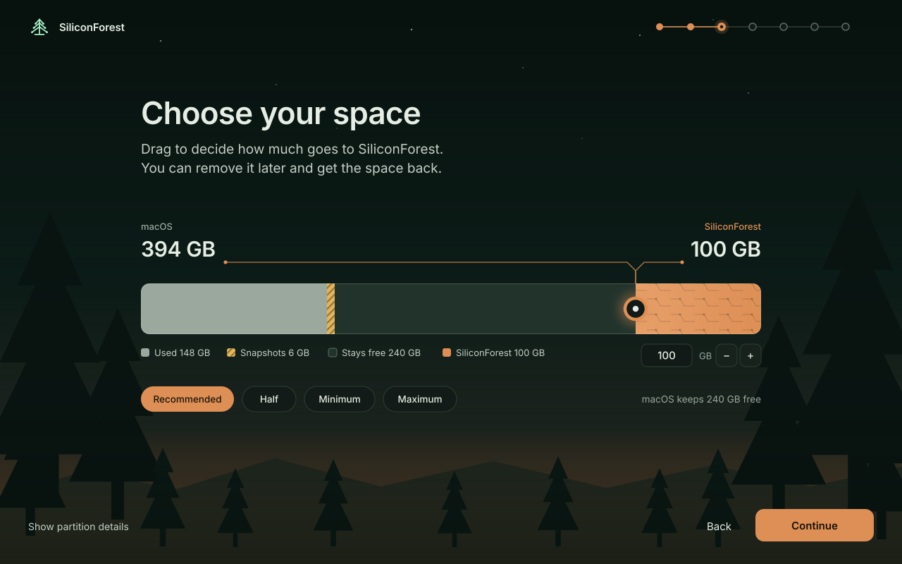

<!-- SPDX-License-Identifier: MIT -->
<!-- Copyright (c) 2026 Chris Kearney and the SiliconForest contributors -->

# SiliconForest Installer: visual design

Companion to [`DESIGN.md`](DESIGN.md) and [`UX-FLOW.md`](UX-FLOW.md).

This direction **uses** the SiliconForest brand as it is. The Canopy, Clearing and other desktop themes, their palettes and their
compositor sources are not changed by anything here.

## 1. The idea: from night to dawn

SiliconForest's brand is two materials growing in layers, a forest and a chip
([`siliconforest-themes.md`](../design/siliconforest-themes.md)). The two dark and light themes are already one scene at two times of day:
**Canopy** is the forest at night, **Clearing** is the same forest at dawn.

**The installer is the night passing.** You arrive under the trees at night. As the work completes, a copper horizon warms, the sky lifts,
and mist appears between the ridgelines. When SiliconForest has actually started on your Mac, you are standing in the Clearing at dawn.

So the background is also the progress indicator, and the most beautiful moment is the true one: it is withheld until the boot receipt exists.

| Stage | Scene | Time of day |
|---|---|---|
| Welcome, Check | Deep Canopy sky, stars, still trees | Night |
| Prepare, Space, Review | A thin copper line on the horizon | First light |
| Installing | Copper rises with real progress | Dawn breaking |
| Recovery | The same scene, frozen | Before sunrise |
| **Finish** | Full Clearing: mist, soft sun | **Morning** |

The second idea is **circuit as structure**. Connectors in the interface are traces, end points are vias, the slider handle is a plated through-hole.
It is used sparingly, wherever something is literally connected: a handle to its label, a step to the next.

## 2. Brand assets

| Asset | Source | Use |
|---|---|---|
| Mark | `integrations/siliconforest/desktop/branding/siliconforest-mark.svg` | Top-left of every screen, app icon, Welcome animation |
| Icon | `integrations/siliconforest/branding/siliconforest-icon.svg` | App icon, dmg, startup picker |
| Boot mark | `integrations/siliconforest/branding/siliconforest-boot.svg` | First-start continuity |
| Scenes | `integrations/siliconforest/desktop/themes/wallpapers/make_wallpapers.py` (`sf-canopy`, `sf-clearing`) | Geometry for The Grove background |

## 3. Colour

Tokens are taken **unchanged** from the theme definitions in `desktop/themes/contrast.py`.

| Token | Canopy (dark) | Clearing (light) |
|---|---|---|
| `surface.raised` | `#17221d` | `#e9ede5` |
| `surface.base` | `#111a16` | `#fbfcf9` |
| `text.primary` | `#e6ede4` | `#1f2a24` |
| `text.secondary` | `#9aa89d` | `#56625a` |
| `line.hairline` | `#2e3d35` | `#b9c3b8` |
| `accent` | `#dd8f55` copper | `#2c7a54` moss |
| `on.accent` | `#1a120b` | `#ffffff` |
| `selection` | `#2b3d33` | `#cfe6d8` |
| `status.critical` | `#ec7c60` | `#cf4a3a` |
| `status.caution` | `#e2b65c` | `#a87004` |
| `status.ok` | `#82c98f` | `#2f8a52` |
| `mark` | `#a6f2c8` | `#2c7a54` |

Disk bar segments, in both appearances:

| Segment | Dark | Light | Non-colour cue |
|---|---|---|---|
| macOS used | `#9aa89d` | `#56625a` | Solid |
| Snapshots | `#e2b65c` | `#a87004` | Diagonal hatch |
| macOS free | `#2e3d35` | `#d8ded5` | Outline |
| SiliconForest | `#dd8f55` | `#2c7a54` | Solid, with a fine trace pattern |

**One accent per screen.** Colour never carries meaning alone: every status has an icon and a word.

## 4. Type

- **Inter** (SIL OFL 1.1), the SiliconForest desktop's own face, bundled with the app and the recovery app. It is loaded with CoreText, so it also works in recoveryOS where our font set is otherwise unknown.
- **Source Code Pro** for logs and technical detail, also matching the desktop.
- The fonts are fetched and pinned at build time. Licence text ships with the app.

| Role | Font | Size / line | Tracking |
|---|---|---|---|
| Display (Welcome) | Inter SemiBold | 72 / 76 | −2.2% |
| Title (each screen) | Inter SemiBold | 44 / 50 | −1.8% |
| Lead | Inter Regular | 20 / 30 | −0.4% |
| Body | Inter Regular | 15 / 23 | 0 |
| Label | Inter Medium | 13 / 18 | 0 |
| Caption | Inter Regular | 12 / 16 | +0.2% |
| Numerals on the disk bar | Inter SemiBold, tabular | 28 / 32 | −1% |
| Log | Source Code Pro | 12 / 18 | 0 |

**Hierarchy rule:** one Title, one Lead, then the work. Left-aligned on a fixed column, with generous empty space. Measure capped at 62 characters.

## 5. Layout

- Base unit **8 pt**. Content column **880 pt** wide, offset to the optical left third on wide displays, centred on the 13-inch display.
- Top bar 72 pt (mark, step dots). Bottom bar 88 pt (Details at left, Back and primary at right). They never move between screens.
- Content sits on the scene with **no card** where contrast allows. Dense content (disk details, logs) uses a `surface.base` panel at 88% opacity with a 1 px hairline and 16 pt radius.
- Respects the camera housing through `NSScreen.safeAreaInsets`.

### The disk bar

The signature control, and the object that carries across Space → Review → Install → Remove in one continuous motion.

- 72 pt tall, 12 pt radius, spanning the content column.
- Real proportions, with a 2 px minimum for tiny segments, whose sizes appear on hover.
- **Handle:** a 28 pt plated via: a ring in `accent` around a dark hole, with a 44 pt hit target. On hover it grows 8%. While dragging, the ring brightens and a fine trace extends up to each size label.
- On macOS 26+, the handle takes Liquid Glass **only while dragging**, matching the HIG's slider behaviour. Earlier versions use a material with a hairline.
- **Hard stop:** a critically damped bump, a haptic on Force Touch trackpads, and the explanation line fades in.
- Numerals use a rolling numeric transition.

### Controls

- **Primary button:** 44 pt tall, 12 pt radius, `accent` fill, `on.accent` text. One per screen.
- **Secondary:** text only. **Destructive:** `status.critical` outline, filled only when armed.
- **Step dots:** vias. Upcoming is an empty ring, current is a filled via with a soft glow, done is a filled via. A hairline trace connects them.
- **Checklist rows:** a via that fills, then a check draws through it.

## 6. Motion

Motion explains what changed. Nothing loops except the slow background.

| Moment | Motion | Duration | Curve |
|---|---|---|---|
| Screen to screen | Title and content rise 16 pt and fade; the old screen drifts up and out | 420 ms | ease-out quint |
| Shared disk bar | Matched geometry between screens | 520 ms | spring, no overshoot |
| Checklist row resolves | Via fills, check draws | 240 ms, 60 ms stagger | ease-out cubic |
| Handle drag | Follows the pointer 1:1 | None | |
| Handle stop | Bump | 180 ms | critically damped |
| Numbers | Rolling digits | 200 ms | ease-out |
| Background dawn | Tied to progress, smoothed | Continuous, under 2% per second | linear |
| Trees and mist | Parallax drift | 60 s period, 4 pt travel | sine |
| Welcome mark | Traces draw, then vias light | 1.4 s once | ease-in-out |
| **Finish** | Vias light outward along the traces | 1.2 s once | ease-out |

**The Grove** is one `MTKView` with a small fragment shader, so it looks identical on macOS 13.5 through the newest. It draws at 30 fps,
pauses when occluded and on battery below 20%, and costs no GPU while Reduce Motion is on. In recovery it is a pre-rendered still.

## 7. macOS version strategy

The deployment target is 13.5. The look does not depend on newer APIs.

| Feature | 13.5 baseline | Newer enhancement |
|---|---|---|
| State | `ObservableObject` | |
| Background | `MTKView` | |
| Sequenced animation | `withAnimation` + state steps | `PhaseAnimator` (14+) |
| Handle material | `Material` + hairline | Liquid Glass while dragging (26+) |
| Full screen | `NSWindow` via a representable | |
| Keyboard | `keyboardShortcut`, `NSEvent` monitor | `.onKeyPress` (14+) |

## 8. Full screen

- Enters **native** full screen at launch, in its own Space (decision D9).
- Keeps menu-bar and Dock reveal, Mission Control, Esc to leave full screen, and force quit. No `disableForceQuit` or process-switching lockouts.
- If the user leaves full screen, the layout continues in a resizable window with a 1024×700 minimum.
- `--windowed` is available for tests.

## 9. Dark, light and accessibility

- **Follows the system appearance.** In dark mode the journey is Canopy → dawn. In light mode it begins in pre-dawn mist and ends in the same Clearing. Panels always use the matching token set.

| Setting | Behaviour |
|---|---|
| **Reduce Motion** | No parallax, no travel. Cross-fades of 150 ms. Dawn steps between stills |
| **Reduce Transparency** | Panels fully opaque. No glass |
| **Increase Contrast** | Hairlines become `text.secondary`. Bar segments get 1 px separators. Scene dimmed behind text |
| **Differentiate Without Color** | Patterns and labels on all segments (on by default for the bar) |
| **VoiceOver** | Every screen announces its title. The disk bar is an adjustable element speaking both sizes. Progress announces phase changes, at most every 10 s |
| **Keyboard** | Everything reachable. Visible focus ring in `accent`. Return is **never** bound to a destructive action |
| **Contrast** | Text at least 4.5:1 against its actual background, measured over the brightest frame of the scene. Tested in CI by rendering |
| **Localisation** | All strings in `SFCopy`, layouts tolerate +40%. English first |

## 10. App icon and dmg

- **App icon:** the mark on a Canopy rounded square with a faint copper horizon, following the macOS icon grid.
- **dmg window:** the Canopy scene as a background, the app on the left, Applications on the right, joined by a copper trace with vias.

## 11. References to capture

No public specification of Setup Assistant exists. Before final polish, capture Setup Assistant and the macOS installer on a real Mac or VM
for type scale, pacing and transitions, and keep those captures out of the repository.
