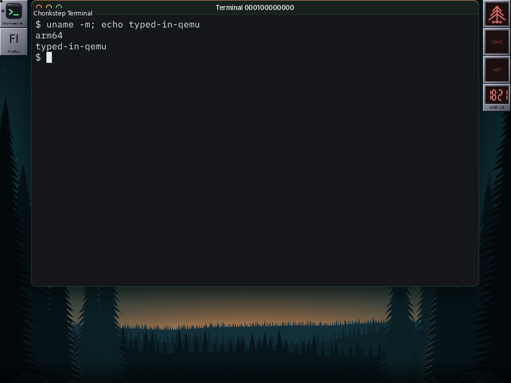

<!-- SPDX-License-Identifier: MIT -->
<!-- Copyright (c) 2026 Chris Kearney and the SiliconForest contributors -->

# Trying SiliconForest in QEMU

The public release root (desktop, dock, terminal, Homebrew and shell tools) can run
on QEMU's arm64 `virt` machine. It uses QEMU's generic kernel collection and firmware
framebuffer. This exercises the root and desktop; M1 drivers, GPU, Wi-Fi, audio,
Touch Bar and hardware compatibility remain outside this test.

## Verified public-clone run

On 18 November 2026, commit `99312ab0555ab1e3dcfcf3fa9a6f0c33ef1f6bba` built all six
outputs in an initially clean container with anonymous public Git, public fetches,
no host mounts or incoming host artifacts, and no acquired Mac firmware or apps.
[The measured receipt](../../reports/build-repro/public-build-001.json) records the
intermediate public-source revisions, final outputs, resource use and complete run.

The exact helper route below used the flake's pinned QEMU 10.2.4, TCG, four virtual
CPUs, 1 GiB guest memory and a 1024×768 framebuffer. The session marker appeared
at 64.7 s and the first desktop frame at 81.3 s. At 18:20:23 UTC, VNC sent real
emulated USB keyboard input: `uname -m; echo typed-in-qemu`. The terminal printed
`arm64` and `typed-in-qemu`, then returned to its prompt. The terminal and both dock
columns remained visible in later captures. The configured 1,500-second lifetime completed with compositor status 0 and complete
managed-app cleanup. Guest process wall time was 1,504 seconds; the desktop result
clock, started after initialization, records 1,488.311 seconds. The lifetime begins
earlier in the terminal launcher; this is not 1,500 seconds after the first frame.
The terminal wrapper was reaped with status 0; its child shell was killed during
bounded shutdown (raw wait status 9), retained explicitly in the receipt.
Both the immutable Nix reference and prepared disk hashes were unchanged.



[The late-session capture](../images/qemu-public-clone-late.png) shows the same
terminal and dock. These are lossless conversions of VNC PPM captures; decoded RGB
pixels match. The dock's instruments retire under slow emulation and appear as
labelled LOAD/NET/CLK tiles. Firefox's launcher is visible, but Firefox was not
started: Mozilla's bundle is outside the build. Pointer interaction, an interactive
host display, sound and networking were not tested.

Earlier IMAGE runs 20 (installed-M1-derived inputs, host QEMU 11.1.0) and 21
(public commit1647a25, pinned QEMU10.2.4) also completed this route. Their distinct
source/input scopes remain in [the image comparison](IMAGE.md#what-is-proven).
The final isolated run above is the public source-build witness.

## Commands

Use x86_64 Linux with Nix and flakes enabled, network access for the pinned public
inputs, and space for the measured build plus compiler scratch files; see
[BUILDING](../BUILDING.md). The review branch is `build-repro`; the receipt identifies
the exact tested source revision. These commands use pinned helper packages, so
Python, debugfs and sfdisk need not already be installed on the host.

```sh
git clone --branch build-repro https://github.com/chriskearney/siliconforest.git
cd siliconforest
nix build .#qemu-reference-image -o result-qemu
nix build .#qemu-runner -o result-runner
export SF_QEMU_REFERENCE="$PWD/result-qemu" SF_QEMU_RUN="$PWD/run"
export QD_RUN="$PWD/result-runner/bin/siliconforest-qemu" TYPE_AFTER=150
nix-shell --pure --keep SF_QEMU_REFERENCE --keep SF_QEMU_RUN --keep QD_RUN --keep TYPE_AFTER \
  -E 'with (import ./release/base.nix).pkgs; mkShell { packages = [ python3 e2fsprogs util-linux coreutils gnugrep ]; }' \
  --run 'set -eu
    sh release/image/qemu/prepare-run.sh "$SF_QEMU_REFERENCE" "$SF_QEMU_RUN" 1500 none
    sh release/image/qemu/run-vnc.sh "$SF_QEMU_RUN" 5400 "uname -m; echo typed-in-qemu"'
# After the finite run ends, read its records from its disposable overlay:
result-runner/bin/siliconforest-qemu-records "$SF_QEMU_RUN"
```

The proof used the same scripts, pinned shell and runner, with the resolved store
paths returned by the six-output build rather than the two result links above.
It additionally compared SHA-256 before and after for the Nix reference and the
prepared disk. Only the per-run overlay is written by the guest; it includes
generated SSH keys and is not a release artifact.

## What you get

- `run/shots/NNN.ppm`: the guest screen every 30 seconds through VNC.
- `run/out/serial.log`: console output. `WMSCALE initial` marks the first desktop
  frame; `QDDESK_DESKTOP_RC=0` and `QDDESK_PASS` mark normal compositor completion.
- `run/out/result.json`: harness summary; inspect the desktop and application
  records as well as this status.
- `run/type.log`: when the keyboard command was sent.
- `run/records`: the extracted session/application cleanup records;
  `run/chonkstep-dock.log`: the dock log.

The writable run belongs to you. Delete it to start again; keep the Nix output immutable.

## Known limits of the QEMU path

- QEMU's screen dump over QMP hung QEMU on the test machine while the desktop was drawing; the
  pictures therefore come through QEMU's VNC server (`release/image/qemu/vnc-shot.py`).
- Under emulation the terminal needs about 27 s to start; the desktop's default deadline is
  25 s. The QEMU session sets `CHONKSTEP_DARWIN_APP_READY_SECONDS=180` and
  `CHONKSTEP_DARWIN_AUTOPILOT_ARM_SECONDS=240`; the hardware keeps the defaults.
- On a busy host the kernel needs `no_lock_timeouts=1` (set on the QEMU disk), or a descheduled
  virtual CPU reads as a deadlock.
